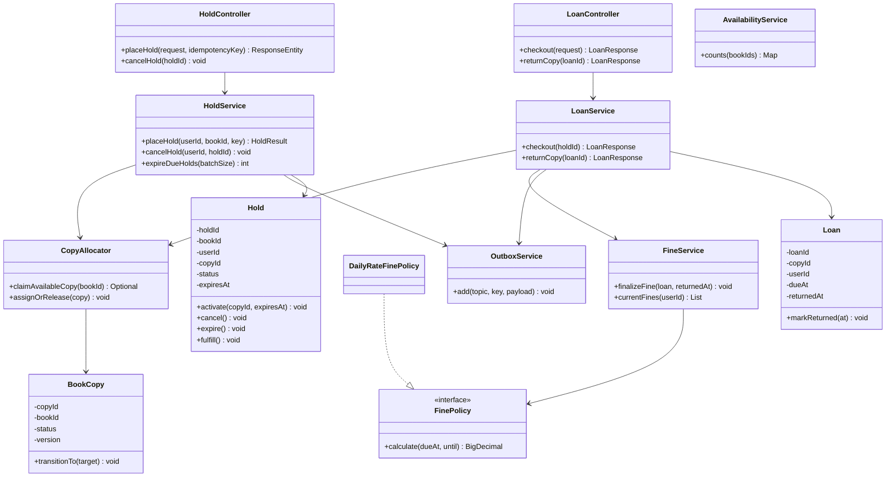
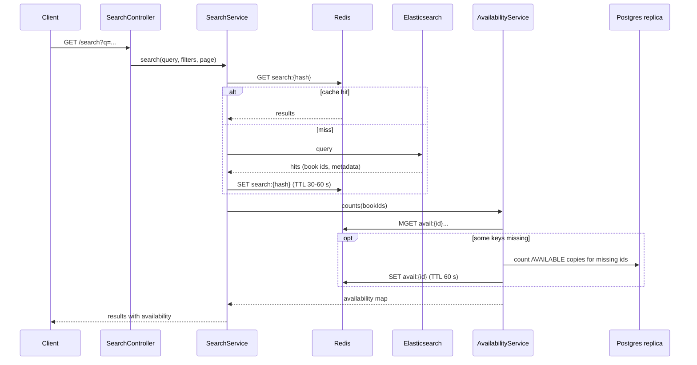

# Library Management System: Low-Level Design (LLD)

This document turns the design in `arch.md` into classes, methods, queries and tests. Requirements are in `problem.md`.

Stack: Java 17, Spring Boot 3, Spring Data JPA, PostgreSQL, Redis, Kafka, Elasticsearch, MongoDB.

## 1. Services and package layout

Three deployable services share nothing except Kafka topics and the API contracts.

| Service | Owns | Stores used |
|---------|------|-------------|
| `search-service` | search queries, availability enrichment | Elasticsearch, Redis, Postgres (read) |
| `catalog-service` | book metadata | MongoDB |
| `booking-service` | copies, holds, loans, fines, jobs, outbox | Postgres, Redis, Kafka |

`booking-service` layout:

```
com.library.booking
├── api
│   ├── HoldController
│   ├── LoanController
│   ├── AccountController          // my loans, my holds, my fines
│   ├── dto                        // request and response records
│   └── GlobalExceptionHandler
├── domain
│   ├── BookCopy, Hold, Loan, Fine, OutboxEvent   // JPA entities
│   ├── CopyStatus, HoldStatus, LoanStatus, FineStatus
│   └── event                      // AvailabilityChanged, domain events
├── service
│   ├── HoldService
│   ├── LoanService
│   ├── CopyAllocator              // conditional claim query
│   ├── FineService
│   ├── FinePolicy, DailyRateFinePolicy
│   ├── EligibilityService         // limits, unpaid fines
│   └── AvailabilityService        // Redis counts with Postgres fallback
├── repository
│   ├── BookCopyRepository, HoldRepository, LoanRepository
│   ├── FineRepository, OutboxRepository
├── outbox
│   ├── OutboxService              // write inside a transaction
│   └── OutboxRelay                // publish to Kafka
├── scheduler
│   ├── HoldExpiryJob
│   └── FineAccrualJob
├── cache
│   └── AvailabilityEvictor        // after-commit cache delete
├── config
│   └── LibraryProperties          // hold TTL, loan period, fine rate
└── exception
    └── DomainException and subclasses
```

## 2. Class diagram



## 3. Design patterns used

| Pattern | Where | Why |
|---------|-------|-----|
| State (guarded transitions) | `CopyStatus.canMoveTo`, `BookCopy.transitionTo` | An illegal status change fails in code before it reaches the database. |
| Strategy | `FinePolicy` | Swap fine rules (flat, per day, per category) without touching `LoanService`. |
| Repository | Spring Data repositories | Keep SQL out of services. |
| Outbox | `OutboxService`, `OutboxRelay` | Never lose an event between commit and Kafka publish. |
| Cache-aside | `AvailabilityService`, `AvailabilityEvictor` | Redis speeds up reads and is never the source of truth. |
| Observer (Spring events) | `AvailabilityChanged` | Evict the cache only after the transaction commits. |
| Idempotent consumer | ES indexer, notification consumer | Kafka delivers at least once. |

## 4. Schema additions to `arch.md`

Add a partial unique index so a member cannot hold the same book twice, even under concurrent requests:

```sql
CREATE UNIQUE INDEX uq_active_hold_per_user_book
    ON holds (user_id, book_id)
    WHERE status IN ('ACTIVE', 'QUEUED');
```

Add an index for the nightly fine job:

```sql
CREATE INDEX idx_loans_overdue ON loans (due_at) WHERE status = 'OPEN';
```

Isolation level: keep PostgreSQL `READ COMMITTED`. Correctness comes from single-statement conditional updates and row locks (`FOR UPDATE`, `SKIP LOCKED`), so `SERIALIZABLE` is not needed.

## 5. Domain model

### 5.1 Enums

```java
public enum CopyStatus {
    AVAILABLE, HELD, CHECKED_OUT, LOST, DAMAGED;

    public boolean canMoveTo(CopyStatus target) {
        return switch (this) {
            case AVAILABLE   -> target == HELD || target == CHECKED_OUT || target == DAMAGED;
            case HELD        -> target == AVAILABLE || target == CHECKED_OUT || target == HELD;
            case CHECKED_OUT -> target == AVAILABLE || target == HELD || target == LOST;
            case LOST, DAMAGED -> target == AVAILABLE;
        };
    }
}

public enum HoldStatus { ACTIVE, QUEUED, FULFILLED, CANCELLED, EXPIRED }
public enum LoanStatus { OPEN, RETURNED }
public enum FineStatus { ACCRUING, FINAL, PAID, WAIVED }
```

### 5.2 Entities

```java
@Entity @Table(name = "book_copy")
public class BookCopy {
    @Id private UUID copyId;
    private String bookId;
    @Enumerated(EnumType.STRING) private CopyStatus status;
    @Version private int version;
    private Instant updatedAt;

    public void transitionTo(CopyStatus target) {
        if (!status.canMoveTo(target)) {
            throw new IllegalStateTransitionException(copyId, status, target);
        }
        this.status = target;
        this.updatedAt = Instant.now();
    }
    // getters
}

@Entity @Table(name = "holds")
public class Hold {
    @Id private UUID holdId;
    private String bookId;
    private UUID userId;
    private UUID copyId;                       // null while QUEUED
    @Enumerated(EnumType.STRING) private HoldStatus status;
    private Instant createdAt;
    private Instant expiresAt;                 // set when a copy is assigned
    private String idempotencyKey;

    public static Hold queued(UUID userId, String bookId, String key, Instant now) { /* ... */ }
    public static Hold active(UUID userId, String bookId, UUID copyId,
                              String key, Instant now, Instant expiresAt) { /* ... */ }

    public void activate(UUID copyId, Instant expiresAt) {
        require(status == HoldStatus.QUEUED);
        this.copyId = copyId; this.expiresAt = expiresAt; this.status = HoldStatus.ACTIVE;
    }
    public void cancel()  { requireOpen(); status = HoldStatus.CANCELLED; }
    public void expire()  { require(status == HoldStatus.ACTIVE); status = HoldStatus.EXPIRED; }
    public void fulfill() { require(status == HoldStatus.ACTIVE); status = HoldStatus.FULFILLED; }
}

@Entity @Table(name = "loans")
public class Loan {
    @Id private UUID loanId;
    private UUID copyId;
    private UUID userId;
    private Instant checkedOutAt;
    private Instant dueAt;
    private Instant returnedAt;
    @Enumerated(EnumType.STRING) private LoanStatus status;

    public static Loan open(UUID copyId, UUID userId, Instant now, Instant dueAt) { /* ... */ }
    public void markReturned(Instant at) {
        require(status == LoanStatus.OPEN);
        this.returnedAt = at; this.status = LoanStatus.RETURNED;
    }
}
```

`Fine` and `OutboxEvent` map the `fines` and `outbox` tables from `arch.md` one to one.

### 5.3 Configuration

```java
@ConfigurationProperties(prefix = "library")
public record LibraryProperties(
    Duration holdTtl,            // 24h
    Duration loanPeriod,         // 14d
    BigDecimal dailyFineRate,    // 0.50
    BigDecimal maxFine,          // 20.00
    int maxActiveHoldsPerUser,   // 5
    BigDecimal blockHoldsAboveFine  // 10.00
) {}
```

## 6. Booking service internals

### 6.1 Claiming a copy

```java
@Component
public class CopyAllocator {

    private final NamedParameterJdbcTemplate jdbc;
    private final HoldRepository holds;
    private final OutboxService outbox;
    private final LibraryProperties props;
    private final Clock clock;

    /** Atomically claims one AVAILABLE copy. Returns empty when none is free. */
    public Optional<UUID> claimAvailableCopy(String bookId) {
        String sql = """
            UPDATE book_copy
               SET status = 'HELD', version = version + 1, updated_at = now()
             WHERE copy_id = (
                   SELECT copy_id FROM book_copy
                    WHERE book_id = :bookId AND status = 'AVAILABLE'
                    LIMIT 1
                    FOR UPDATE SKIP LOCKED)
            RETURNING copy_id
            """;
        List<UUID> rows = jdbc.query(sql, Map.of("bookId", bookId),
                (rs, i) -> rs.getObject("copy_id", UUID.class));
        return rows.stream().findFirst();
    }

    /** Called when a copy becomes free (return, cancel, expiry). Caller holds the copy row lock. */
    public void assignOrRelease(BookCopy copy) {
        Optional<Hold> next = holds.lockNextQueued(copy.getBookId());
        if (next.isPresent()) {
            Hold hold = next.get();
            hold.activate(copy.getCopyId(), clock.instant().plus(props.holdTtl()));
            copy.transitionTo(CopyStatus.HELD);
            outbox.add("hold.events", hold.getUserId().toString(),
                       new HoldReady(hold.getHoldId(), hold.getUserId(), copy.getBookId(), hold.getExpiresAt()));
        } else {
            copy.transitionTo(CopyStatus.AVAILABLE);
        }
    }
}
```

`HoldRepository.lockNextQueued`:

```java
@Query(value = """
    SELECT * FROM holds
     WHERE book_id = :bookId AND status = 'QUEUED'
     ORDER BY created_at
     LIMIT 1
     FOR UPDATE SKIP LOCKED
    """, nativeQuery = true)
Optional<Hold> lockNextQueued(@Param("bookId") String bookId);
```

Note: `SKIP LOCKED` keeps jobs and returns from blocking each other. If two copies of the same book are freed at the same moment, the second one may take the second waiter. Order is still first come, first served per copy.

### 6.2 Place a hold

```java
@Service
public class HoldService {

    @Transactional
    public HoldResult placeHold(UUID userId, String bookId, String idempotencyKey) {
        // 1. Replay: the same key returns the same hold.
        Optional<Hold> existing = holds.findByUserIdAndIdempotencyKey(userId, idempotencyKey);
        if (existing.isPresent()) return HoldResult.of(existing.get());

        // 2. Business rules.
        eligibility.check(userId, bookId);   // max active holds, unpaid fines, duplicate hold

        // 3. Claim a copy or join the waitlist.
        Instant now = clock.instant();
        Optional<UUID> copyId = allocator.claimAvailableCopy(bookId);
        Hold hold = copyId
            .map(id -> Hold.active(userId, bookId, id, idempotencyKey, now, now.plus(props.holdTtl())))
            .orElseGet(() -> Hold.queued(userId, bookId, idempotencyKey, now));

        try {
            holds.saveAndFlush(hold);
        } catch (DataIntegrityViolationException e) {
            // Concurrent duplicate (same key, or same user and book): roll back the claim and replay.
            throw new DuplicateHoldException(userId, bookId);
        }

        // 4. Event and cache eviction (runs after commit).
        outbox.add("hold.events", userId.toString(), HoldPlaced.from(hold));
        events.publishEvent(new AvailabilityChanged(bookId));

        return HoldResult.of(hold);
    }
}
```

Why the `catch` is safe: the exception rolls back the whole transaction, including the copy claim, so the copy returns to `AVAILABLE`. The controller maps the replayed idempotency key to the original hold (see 6.7).

`EligibilityService.check` rejects the request when:

- the member has `maxActiveHoldsPerUser` active or queued holds,
- the member's unpaid fines are above `blockHoldsAboveFine`,
- the member already has an active or queued hold for this book,
- the member's account is not `ACTIVE`.

### 6.3 Checkout

```java
@Transactional
public LoanResponse checkout(UUID holdId) {
    Hold hold = holds.findByIdForUpdate(holdId).orElseThrow(() -> new HoldNotFoundException(holdId));
    Instant now = clock.instant();

    if (hold.getStatus() != HoldStatus.ACTIVE)  throw new HoldNotActiveException(holdId);
    if (hold.getExpiresAt().isBefore(now))      throw new HoldExpiredException(holdId);

    BookCopy copy = copies.findByIdForUpdate(hold.getCopyId()).orElseThrow();
    copy.transitionTo(CopyStatus.CHECKED_OUT);   // HELD -> CHECKED_OUT, availability count unchanged
    hold.fulfill();

    Loan loan = Loan.open(copy.getCopyId(), hold.getUserId(), now, now.plus(props.loanPeriod()));
    loans.save(loan);

    outbox.add("loan.events", hold.getUserId().toString(), LoanCreated.from(loan));
    return LoanResponse.of(loan);
}
```

The `findByIdForUpdate` methods use `@Lock(LockModeType.PESSIMISTIC_WRITE)`. This blocks a simultaneous expiry job on the same hold until checkout commits.

Walk-in checkout (no hold): the librarian endpoint calls `claimAvailableCopy`, then sets the copy straight to `CHECKED_OUT`. It uses the same claim query, so it cannot take a copy that is on hold.

### 6.4 Return

```java
@Transactional
public LoanResponse returnCopy(UUID loanId) {
    Loan loan = loans.findByIdForUpdate(loanId).orElseThrow(() -> new LoanNotFoundException(loanId));
    if (loan.getStatus() == LoanStatus.RETURNED) return LoanResponse.of(loan);   // idempotent

    Instant now = clock.instant();
    loan.markReturned(now);
    fines.finalizeFine(loan, now);

    BookCopy copy = copies.findByIdForUpdate(loan.getCopyId()).orElseThrow();
    allocator.assignOrRelease(copy);     // next waitlisted member, or AVAILABLE

    outbox.add("loan.events", loan.getUserId().toString(), LoanReturned.from(loan));
    events.publishEvent(new AvailabilityChanged(copy.getBookId()));
    return LoanResponse.of(loan);
}
```

### 6.5 Cancel and expire holds

```java
@Transactional
public void cancelHold(UUID userId, UUID holdId) {
    Hold hold = holds.findByIdForUpdate(holdId).orElseThrow(() -> new HoldNotFoundException(holdId));
    if (!hold.getUserId().equals(userId)) throw new ForbiddenException();

    boolean hadCopy = hold.getStatus() == HoldStatus.ACTIVE;
    hold.cancel();                                   // ACTIVE or QUEUED -> CANCELLED
    if (hadCopy) {
        BookCopy copy = copies.findByIdForUpdate(hold.getCopyId()).orElseThrow();
        allocator.assignOrRelease(copy);
        events.publishEvent(new AvailabilityChanged(copy.getBookId()));
    }
}

@Transactional
public int expireDueHolds(int batchSize) {
    List<Hold> due = holds.lockExpiredActive(clock.instant(), batchSize);   // FOR UPDATE SKIP LOCKED
    for (Hold hold : due) {
        hold.expire();
        BookCopy copy = copies.findByIdForUpdate(hold.getCopyId()).orElseThrow();
        allocator.assignOrRelease(copy);
        outbox.add("hold.events", hold.getUserId().toString(), HoldExpired.from(hold));
        events.publishEvent(new AvailabilityChanged(copy.getBookId()));
    }
    return due.size();
}
```

### 6.6 Fines

```java
public interface FinePolicy {
    BigDecimal calculate(Instant dueAt, Instant until);
}

@Component
public class DailyRateFinePolicy implements FinePolicy {
    private final LibraryProperties props;

    @Override
    public BigDecimal calculate(Instant dueAt, Instant until) {
        long seconds = Duration.between(dueAt, until).getSeconds();
        if (seconds <= 0) return BigDecimal.ZERO;
        long days = (seconds + 86_399) / 86_400;                 // round up to whole days
        return props.dailyFineRate().multiply(BigDecimal.valueOf(days)).min(props.maxFine());
    }
}
```

`FineService.finalizeFine(loan, returnedAt)`:

1. Compute the amount with the policy.
2. If the amount is zero, do nothing.
3. Otherwise, upsert the `fines` row for the loan with status `FINAL`.

Nightly accrual (set-based SQL, one statement for all overdue loans):

```sql
INSERT INTO fines (fine_id, loan_id, user_id, days_overdue, amount, status, updated_at)
SELECT gen_random_uuid(), l.loan_id, l.user_id,
       CEIL(EXTRACT(EPOCH FROM (now() - l.due_at)) / 86400)::int,
       LEAST(CEIL(EXTRACT(EPOCH FROM (now() - l.due_at)) / 86400) * :rate, :cap),
       'ACCRUING', now()
  FROM loans l
 WHERE l.status = 'OPEN' AND l.due_at < now()
ON CONFLICT (loan_id) DO UPDATE
   SET days_overdue = EXCLUDED.days_overdue,
       amount       = EXCLUDED.amount,
       updated_at   = now()
 WHERE fines.status = 'ACCRUING';
```

The SQL and `DailyRateFinePolicy` must give the same result. A test in section 12 checks this.

### 6.7 Controllers

```java
@RestController
@RequestMapping("/holds")
public class HoldController {

    @PostMapping
    @PreAuthorize("hasRole('MEMBER')")
    public ResponseEntity<HoldResponse> placeHold(
            @AuthenticationPrincipal UserPrincipal user,
            @RequestHeader("Idempotency-Key") String key,
            @Valid @RequestBody PlaceHoldRequest request) {

        HoldResult result = holdService.placeHold(user.id(), request.bookId(), key);
        HttpStatus status = result.status() == HoldStatus.ACTIVE ? HttpStatus.CREATED : HttpStatus.ACCEPTED;
        return ResponseEntity.status(status).body(HoldResponse.of(result));
    }

    @DeleteMapping("/{holdId}")
    @PreAuthorize("hasRole('MEMBER')")
    public ResponseEntity<Void> cancel(@AuthenticationPrincipal UserPrincipal user, @PathVariable UUID holdId) {
        holdService.cancelHold(user.id(), holdId);
        return ResponseEntity.noContent().build();
    }
}
```

For `DuplicateHoldException` caused by a concurrent request with the same `Idempotency-Key`, the exception handler looks up the existing hold by `(userId, key)` and returns it with `200`.

### 6.8 Outbox

```java
@Service
public class OutboxService {
    @Transactional(propagation = Propagation.MANDATORY)       // must join the caller's transaction
    public void add(String topic, String key, Object payload) {
        outboxRepo.save(OutboxEvent.of(topic, key, objectMapper.writeValueAsString(payload)));
    }
}

@Component
public class OutboxRelay {

    @Scheduled(fixedDelay = 500)
    public void publishBatch() {
        template.executeWithoutResult(status -> {
            List<OutboxEvent> batch = outboxRepo.lockUnpublished(100);   // FOR UPDATE SKIP LOCKED, ORDER BY id
            for (OutboxEvent e : batch) {
                kafka.send(e.getTopic(), e.getKey(), e.getPayload()).get(5, TimeUnit.SECONDS);
                e.markPublished(clock.instant());
            }
        });
    }
}
```

Delivery is at least once: a crash after `send` but before commit republishes the row. Consumers must ignore duplicates (use the outbox `id` as the event id).

### 6.9 Cache eviction after commit

```java
public record AvailabilityChanged(String bookId) {}

@Component
public class AvailabilityEvictor {
    @TransactionalEventListener(phase = TransactionPhase.AFTER_COMMIT)
    public void on(AvailabilityChanged event) {
        try {
            redis.delete("avail:" + event.bookId());
        } catch (Exception e) {
            log.warn("Redis evict failed for {}; TTL will heal it", event.bookId(), e);
        }
    }
}
```

A Redis failure never fails the booking request. The 60-second TTL fixes any stale value.

### 6.10 Scheduled jobs

```java
@Component
public class HoldExpiryJob {
    @Scheduled(fixedDelay = 60_000)
    public void run() {
        int processed;
        do {
            processed = holdService.expireDueHolds(100);      // each call is its own transaction
        } while (processed == 100);
    }
}
```

`FineAccrualJob` runs the SQL from 6.6 once per night (`@Scheduled(cron = "0 30 1 * * *")`). Several instances can run safely: the expiry job uses `SKIP LOCKED`, and the fine upsert is idempotent.

## 7. Search service internals

### 7.1 Flow



The search result cache stores only metadata. Availability is joined after the cache lookup, so cached results never show old availability beyond the 60-second availability TTL.

### 7.2 Query

```json
{
  "from": 0,
  "size": 20,
  "query": {
    "bool": {
      "must": [{
        "multi_match": {
          "query": "data intensive",
          "fields": ["title^3", "authors^2", "tags"],
          "type": "best_fields",
          "fuzziness": "AUTO"
        }
      }],
      "filter": [
        { "term": { "genres": "computing" } },
        { "term": { "language": "en" } }
      ]
    }
  }
}
```

Rules:

- `size` is capped at 50. `from + size` is capped at 1,000. Deeper paging is rejected with `400`.
- An ISBN-looking query (10 or 13 digits) uses a `term` query on `isbn`.
- The cache key is a hash of the normalized query, filters and page.

### 7.3 Availability lookup

```java
public Map<String, Integer> counts(List<String> bookIds) {
    List<String> keys = bookIds.stream().map(id -> "avail:" + id).toList();
    List<String> cached = redis.opsForValue().multiGet(keys);          // null entries are misses

    Map<String, Integer> result = new HashMap<>();
    List<String> missing = new ArrayList<>();
    for (int i = 0; i < bookIds.size(); i++) {
        if (cached != null && cached.get(i) != null) result.put(bookIds.get(i), Integer.parseInt(cached.get(i)));
        else missing.add(bookIds.get(i));
    }
    if (!missing.isEmpty()) {
        Map<String, Integer> fromDb = copyReadRepo.countAvailable(missing);   // GROUP BY book_id on the replica
        for (String id : missing) {
            int n = fromDb.getOrDefault(id, 0);                                // zero is cached too
            result.put(id, n);
            redis.opsForValue().set("avail:" + id, String.valueOf(n), Duration.ofSeconds(60));
        }
    }
    return result;
}
```

If Redis is down, wrap the Redis calls in a try/catch and read everything from the replica. Cap the fallback query to one page of ids (at most 50).

## 8. Catalog service and index sync

### 8.1 Catalog service

```java
@Document("books")
public record Book(
    @Id String bookId, String isbn, String title, List<String> authors,
    List<String> genres, String language, Integer publicationYear,
    List<String> tags, String description, Instant updatedAt) {}
```

- `POST /catalog/books` validates the ISBN format and rejects a duplicate ISBN (unique index on `isbn`), then saves to MongoDB.
- When a book is created, the catalog service also asks the booking service to create its copy rows (or a librarian adds copies with `POST /catalog/books/{id}/copies`). Copies live in Postgres, not MongoDB.
- `GET /books/{id}` reads MongoDB and uses the `book:{id}` cache (5 minutes). Updates evict that key.

### 8.2 Index sync consumer

```java
@KafkaListener(topics = "catalog.books", groupId = "es-indexer")
public void onChange(ConsumerRecord<String, String> record, Acknowledgment ack) {
    String bookId = record.key();
    if (record.value() == null) {                       // delete event (tombstone)
        es.delete(d -> d.index("books").id(bookId));
    } else {
        BookDoc doc = mapper.toDoc(record.value());     // extract fields from the Debezium payload
        es.index(i -> i.index("books").id(bookId)
                       .document(doc)
                       .version(doc.sourceTimestamp())              // ts_ms from the change event
                       .versionType(VersionType.External));         // older events are rejected
    }
    ack.acknowledge();                                  // after Elasticsearch accepts the write
}
```

- The document id is `bookId`, so replays overwrite the same document.
- External versioning stops an old event from overwriting a newer one if events arrive out of order. A version conflict is ignored, not retried.
- Retry transient errors with backoff. After 5 failures, send the record to `catalog.books.dlq` and alert.
- To rebuild: create `books_v2`, replay the topic or scan MongoDB into it, then move the `books` alias.

## 9. API contracts

### 9.1 Place a hold

```
POST /holds
Authorization: Bearer <jwt>
Idempotency-Key: 7c9e6679-7425-40de-944b-e07fc1f90ae7
Content-Type: application/json

{ "bookId": "b-123" }
```

Copy available: `201 Created`

```json
{
  "holdId": "0f8fad5b-d9cb-469f-a165-70867728950e",
  "bookId": "b-123",
  "status": "ACTIVE",
  "expiresAt": "2026-10-30T10:15:00Z",
  "queuePosition": null
}
```

No copy available: `202 Accepted`

```json
{
  "holdId": "5a3c1c1e-3a1c-4b5e-8a39-2f4f1b9a7d10",
  "bookId": "b-123",
  "status": "QUEUED",
  "expiresAt": null,
  "queuePosition": 3
}
```

### 9.2 Checkout and return

```
POST /loans
{ "holdId": "0f8fad5b-d9cb-469f-a165-70867728950e" }
```

`201 Created`

```json
{
  "loanId": "c1a7f0a2-6a54-4d1c-9f3e-0b6d7a5e1d22",
  "copyId": "9d2e5f44-1b0a-4e55-a1c1-7a6b8a2f33aa",
  "userId": "3b1c2f77-0f2d-4c8e-9b8a-5a4d6c7e8f90",
  "checkedOutAt": "2026-10-30T10:20:00Z",
  "dueAt": "2026-11-13T10:20:00Z",
  "status": "OPEN"
}
```

```
POST /loans/{loanId}/return
```

`200 OK`

```json
{
  "loanId": "c1a7f0a2-6a54-4d1c-9f3e-0b6d7a5e1d22",
  "status": "RETURNED",
  "returnedAt": "2026-11-16T09:00:00Z",
  "fine": { "daysOverdue": 3, "amount": 1.50, "status": "FINAL" }
}
```

### 9.3 Search

```
GET /search?q=data+intensive&genre=computing&lang=en&page=0&size=20
```

`200 OK`

```json
{
  "page": 0,
  "size": 20,
  "total": 14,
  "results": [
    {
      "bookId": "b-123",
      "title": "Designing Data-Intensive Applications",
      "authors": ["Martin Kleppmann"],
      "isbn": "9781449373320",
      "availableCopies": 2
    }
  ]
}
```

### 9.4 Error format and codes

```json
{
  "code": "NO_COPY_AVAILABLE",
  "message": "No copy is available for this book",
  "traceId": "4bf92f3577b34da6a3ce929d0e0e4736"
}
```

| Code | HTTP | When |
|------|------|------|
| `VALIDATION_ERROR` | 400 | bad input, missing `Idempotency-Key`, search paging too deep |
| `UNAUTHENTICATED` | 401 | missing or invalid JWT |
| `FORBIDDEN` | 403 | wrong role, or a member touching another member's hold |
| `NOT_FOUND` | 404 | unknown book, hold or loan |
| `HOLD_NOT_ACTIVE` | 409 | checkout of a hold that is queued, cancelled or fulfilled |
| `DUPLICATE_HOLD` | 409 | the member already has an open hold for this book |
| `ILLEGAL_STATE_TRANSITION` | 409 | a copy status change the state machine does not allow |
| `HOLD_EXPIRED` | 422 | checkout after `expiresAt` |
| `HOLD_LIMIT_REACHED` | 422 | too many open holds |
| `UNPAID_FINES` | 422 | fines above the block threshold |
| `RATE_LIMITED` | 429 | gateway rate limit |
| `INTERNAL_ERROR` | 500 | unexpected error |
| `SERVICE_UNAVAILABLE` | 503 | dependency down or lock timeout |

`GlobalExceptionHandler` maps each `DomainException` subclass to one code and HTTP status, and adds the trace id from the request context.

## 10. Concurrency cases

| Case | What happens | Mechanism |
|------|--------------|-----------|
| Two members request the last copy at once | One claim returns a row, the other returns none and joins the waitlist | conditional `UPDATE` with `FOR UPDATE SKIP LOCKED` |
| Same member double-clicks (same `Idempotency-Key`) | Second call returns the first hold | unique `(user_id, idempotency_key)` |
| Same member holds the same book from two devices (different keys) | Second request gets `DUPLICATE_HOLD` and its transaction rolls back, freeing any claimed copy | partial unique index `uq_active_hold_per_user_book` |
| Checkout while the expiry job processes the same hold | One waits for the other. After the job commits, checkout sees `EXPIRED` and fails. | `FOR UPDATE` on the hold row |
| Two returns of the same loan | Second returns the stored result | row lock plus status check |
| Return and cancel on the same book at the same time | Each locks its own copy row. `SKIP LOCKED` stops both from taking the same waiter. | `lockNextQueued` |
| Hot book, many requests | Winners claim copies, others queue or fail fast | short `lock_timeout` (200 ms), mapped to `503` or the waitlist |
| Expiry job running on several instances | Each takes a different batch | `FOR UPDATE SKIP LOCKED` |

Set `spring.jpa.properties.jakarta.persistence.lock.timeout=200` so a blocked lock fails fast.

## 11. Error handling and resilience

- **Redis errors** never fail a request. Log and fall back (see 6.9 and 7.3).
- **Elasticsearch errors:** return cached results if present, otherwise `503`.
- **Kafka errors:** the outbox keeps events in Postgres, so a Kafka outage delays notifications but loses nothing.
- **Timeouts:** gateway to service 2 s, service to Elasticsearch 500 ms, service to Redis 100 ms, Postgres statement timeout 2 s.
- **Retries:** only on idempotent reads and on outbox publishing. Never retry a booking write inside the service. The client retries with the same `Idempotency-Key`.
- **Circuit breaker** (Resilience4j) around Elasticsearch calls.
- **Connection pools:** HikariCP size 20 per instance, PgBouncer in front of Postgres.

## 12. Test plan

### 12.1 Unit tests

| Test | Checks |
|------|--------|
| `CopyStatusTest` | every allowed and forbidden transition |
| `DailyRateFinePolicyTest` | 0 days late, 1 second late (1 day), exactly 24 h, 3 days, cap reached |
| `HoldTest` | `activate`, `cancel`, `expire`, `fulfill` reject wrong states |
| `EligibilityServiceTest` | hold limit, unpaid fines, duplicate hold, inactive account |

### 12.2 Integration tests (Testcontainers: Postgres, Redis, Kafka, Elasticsearch, MongoDB)

| Test | Checks |
|------|--------|
| Hold, checkout, return happy path | statuses and events at every step |
| Return promotes the waitlist | oldest queued hold becomes ACTIVE with the copy, others stay queued |
| Cancel an active hold | copy goes to next waiter or AVAILABLE |
| Expiry job | expired hold frees the copy and notifies the next waiter |
| Idempotent replay | same key returns the same hold, no second copy claimed |
| Outbox | event row is published once, `published_at` set, rollback leaves no event |
| Catalog sync | create, update and delete in MongoDB appear in Elasticsearch, out-of-order event is ignored |
| Fine parity | for sample loans, the nightly SQL result equals `DailyRateFinePolicy` |
| Redis outage | booking still succeeds, search falls back |

### 12.3 Concurrency test

```java
@Test
void fiveCopies_hundredMembers_noDoubleBooking() throws Exception {
    seedCopies("b-1", 5);
    List<UUID> users = seedUsers(100);
    ExecutorService pool = Executors.newFixedThreadPool(50);
    CountDownLatch start = new CountDownLatch(1);

    List<Future<HoldResult>> futures = users.stream()
        .map(u -> pool.submit(() -> {
            start.await();
            return holdService.placeHold(u, "b-1", UUID.randomUUID().toString());
        })).toList();

    start.countDown();
    List<HoldResult> results = collect(futures);

    assertThat(count(results, HoldStatus.ACTIVE)).isEqualTo(5);
    assertThat(count(results, HoldStatus.QUEUED)).isEqualTo(95);
    assertThat(distinctCopyIds(results)).hasSize(5);          // no copy assigned twice
    assertThat(copyRepo.countByBookIdAndStatus("b-1", CopyStatus.HELD)).isEqualTo(5);
}
```

### 12.4 Load test (k6 or Gatling)

- Baseline: 1,500 RPS, 90% search and 10% booking, 10 minutes. Expect p95 under 200 ms.
- Spike: ramp to 4,500 RPS. Expect p95 under 200 ms with autoscaling and the search cache on.
- Hot book: 500 members request the same book. Expect no double booking, bounded latency, and `409` or queued responses for the rest.
- Failure drills: stop Redis, stop one Elasticsearch node, fail over Postgres. Expect no wrong data and recovery within the availability target.

## 13. Open points

- Choose the final values for hold time, loan period, fine rate and fine cap (defaults above).
- Decide whether holds can be placed on a specific branch's copy or on any copy of the title.
- Decide the policy for lost books (charge the replacement price and close the loan).
- Add authentication details (token issuer, refresh) once the user service is designed.
