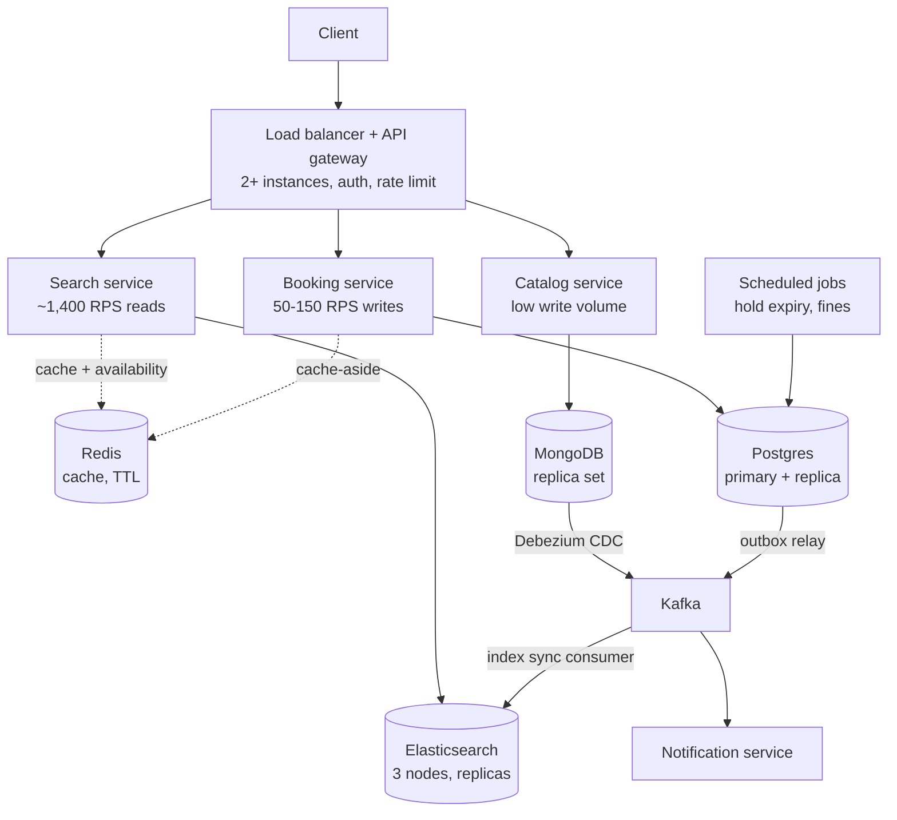
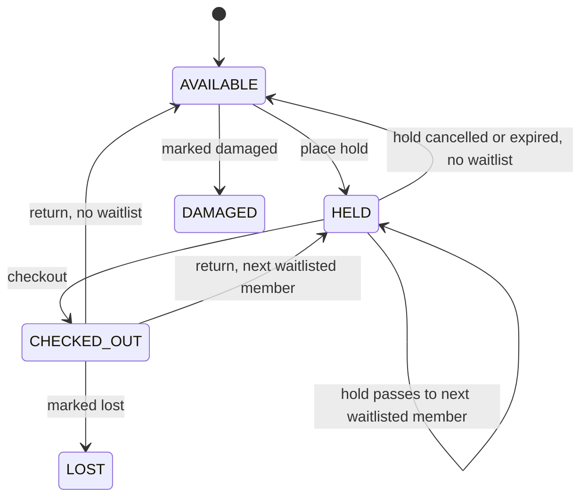

# Library Management System: Architecture (HLD)

Requirements and estimates are in `problem.md`. This document covers the design and its internals.

## 1. Design goals

1. Never double book a copy (Postgres is the source of truth).
2. Serve search from an index built for it (Elasticsearch).
3. Keep the system simple: standard components, no stream engines.
4. Scale services horizontally and remove single points of failure.

## 2. High-level architecture



Legend: solid arrows are the main path, dashed arrows are the optional cache path.

| Layer | Components |
|-------|-----------|
| Edge | Load balancer, API gateway |
| Services | Search, Catalog, Booking, Notification, Scheduled jobs |
| Data stores | Postgres (transactions), MongoDB (catalog), Elasticsearch (search index), Redis (cache) |
| Messaging | Kafka (catalog sync, events) |

## 3. Components

### 3.1 Load balancer and API gateway

- Run 2 or more instances across availability zones.
- Verify the JWT, enforce roles (member, librarian, admin) and route by path.
- Rate limit per user (normal use is 1 req/s, so cap at about 5 req/s) and per IP.
- Forward the `Idempotency-Key` header on hold and checkout calls.
- Apply timeouts and retries to upstream calls.

### 3.2 Search service

- Stateless and read-only.
- Query Elasticsearch for matches, then enrich each result with its availability count from Redis (`MGET`), falling back to Postgres on a miss.
- Cache popular query results in Redis for 30 to 60 seconds.
- Cap page size and pagination depth (for example, 50 results per page, no pages deeper than 1,000 results).

### 3.3 Catalog service

- Owns book metadata. Writes go to MongoDB, and reads of one book by id also come from MongoDB.
- Librarian-only create and update endpoints.
- Does not query Elasticsearch directly. All search goes through the Search service.

### 3.4 Booking service

- Owns holds, loans, returns and the waitlist.
- Every state change is a transaction in Postgres.
- After commit, delete the book's availability key in Redis.
- Writes an outbox row in the same transaction for events (see 5.5).

### 3.5 Scheduled jobs

- **Hold expiry job** (every minute): expire holds past `expires_at` and pass the copy to the next waitlisted member (see 5.4).
- **Fine job** (nightly): compute fines for open overdue loans (see 5.6).
- Run several instances safely using `FOR UPDATE SKIP LOCKED`.

### 3.6 Notification service

- Consumes events from Kafka (hold ready, hold expiring, due soon, overdue) and sends email or SMS.

## 4. Data stores and why

| Store | Holds | Why |
|-------|-------|-----|
| Postgres | Copies, holds, loans, fines | Needs transactions and row-level concurrency control. Writes are only a few hundred per second. |
| MongoDB | Book metadata | Flexible document shape (authors, editions, tags). Source of truth for the catalog. |
| Elasticsearch | Search index | Full-text search, ranking, filters. A derived copy of the catalog, rebuildable from MongoDB. |
| Redis | Search cache, availability counts | Sub-millisecond reads. Never the source of truth. |
| Kafka | Catalog change events, domain events | Buffers CDC events and decouples consumers. Supports replay and reindexing. |

## 5. Internals

### 5.1 Data model (Postgres)

```sql
CREATE TABLE users (
    user_id     UUID PRIMARY KEY,
    name        TEXT NOT NULL,
    email       TEXT UNIQUE NOT NULL,
    role        TEXT NOT NULL,            -- MEMBER, LIBRARIAN, ADMIN
    status      TEXT NOT NULL DEFAULT 'ACTIVE'
);

-- One row per physical copy. book_id refers to the MongoDB catalog document.
CREATE TABLE book_copy (
    copy_id     UUID PRIMARY KEY,
    book_id     TEXT NOT NULL,
    status      TEXT NOT NULL,            -- AVAILABLE, HELD, CHECKED_OUT, LOST, DAMAGED
    version     INT  NOT NULL DEFAULT 0,
    updated_at  TIMESTAMPTZ NOT NULL DEFAULT now()
);
CREATE INDEX idx_copy_book_status ON book_copy (book_id, status);

CREATE TABLE holds (
    hold_id         UUID PRIMARY KEY,
    book_id         TEXT NOT NULL,
    user_id         UUID NOT NULL REFERENCES users(user_id),
    copy_id         UUID REFERENCES book_copy(copy_id),   -- NULL while waitlisted
    status          TEXT NOT NULL,        -- ACTIVE, QUEUED, FULFILLED, CANCELLED, EXPIRED
    created_at      TIMESTAMPTZ NOT NULL DEFAULT now(),
    expires_at      TIMESTAMPTZ,          -- set when a copy is assigned
    idempotency_key TEXT NOT NULL,
    UNIQUE (user_id, idempotency_key)
);
CREATE INDEX idx_holds_queue  ON holds (book_id, status, created_at);
CREATE INDEX idx_holds_expiry ON holds (status, expires_at);

CREATE TABLE loans (
    loan_id        UUID PRIMARY KEY,
    copy_id        UUID NOT NULL REFERENCES book_copy(copy_id),
    user_id        UUID NOT NULL REFERENCES users(user_id),
    checked_out_at TIMESTAMPTZ NOT NULL,
    due_at         TIMESTAMPTZ NOT NULL,
    returned_at    TIMESTAMPTZ,
    status         TEXT NOT NULL          -- OPEN, RETURNED
);
CREATE INDEX idx_loans_open_due ON loans (status, due_at);
-- A copy can have only one open loan:
CREATE UNIQUE INDEX uq_loan_open_copy ON loans (copy_id) WHERE status = 'OPEN';

CREATE TABLE fines (
    fine_id      UUID PRIMARY KEY,
    loan_id      UUID UNIQUE NOT NULL REFERENCES loans(loan_id),
    user_id      UUID NOT NULL REFERENCES users(user_id),
    days_overdue INT  NOT NULL,
    amount       NUMERIC(10,2) NOT NULL,
    status       TEXT NOT NULL,           -- ACCRUING, FINAL, PAID, WAIVED
    updated_at   TIMESTAMPTZ NOT NULL DEFAULT now()
);

CREATE TABLE outbox (
    id           BIGSERIAL PRIMARY KEY,
    topic        TEXT NOT NULL,
    payload      JSONB NOT NULL,
    created_at   TIMESTAMPTZ NOT NULL DEFAULT now(),
    published_at TIMESTAMPTZ
);
```

### 5.2 Copy state machine



### 5.3 Place a hold (no double booking)

Database rule: the copy is claimed by a conditional update. If the update touches 0 rows, someone else got it.

```sql
-- inside one transaction
-- 1. claim any available copy of the book
UPDATE book_copy
SET status = 'HELD', version = version + 1, updated_at = now()
WHERE copy_id = (
    SELECT copy_id FROM book_copy
    WHERE book_id = :book_id AND status = 'AVAILABLE'
    LIMIT 1
    FOR UPDATE SKIP LOCKED
)
RETURNING copy_id;

-- 2a. a row came back: insert an ACTIVE hold with expires_at = now() + hold_ttl
-- 2b. no row came back: insert a QUEUED hold (waitlist)
-- 3. insert an outbox event
```

```mermaid
sequenceDiagram
    participant C as Client
    participant G as Gateway
    participant B as Booking service
    participant P as Postgres
    participant R as Redis
    participant K as Kafka

    C->>G: POST /holds (Idempotency-Key)
    G->>B: forward (user, key)
    B->>P: BEGIN; claim copy (conditional update)
    alt copy claimed
        B->>P: insert hold ACTIVE + outbox row; COMMIT
        B->>R: DEL avail:{bookId}
        B-->>C: 201 hold ACTIVE, expires_at
    else no copy free
        B->>P: insert hold QUEUED + outbox row; COMMIT
        B-->>C: 202 hold QUEUED, position
    end
    P-->>K: outbox relay publishes event
```

Idempotency: the `UNIQUE (user_id, idempotency_key)` constraint makes a retried request return the original hold instead of creating a second one.

Contention: when many members request the same new bestseller, the winners claim copies and the rest are queued or rejected quickly. Set a short `lock_timeout` (for example 200 ms) so requests do not pile up.

### 5.4 Checkout, return, cancel and expiry

**Checkout** (librarian scans the copy for the member with an ACTIVE hold)

1. Verify the hold is ACTIVE, belongs to the member and has not expired.
2. In one transaction: set the copy to `CHECKED_OUT`, mark the hold `FULFILLED`, insert a loan with `due_at`.
3. Delete the Redis availability key after commit.

**Return**

1. In one transaction: set the loan to `RETURNED` and set `returned_at`.
2. Finalize the fine if overdue (see 5.6).
3. Find the oldest `QUEUED` hold for this book using `FOR UPDATE SKIP LOCKED`.
   - If one exists: assign the copy to it (copy `HELD`, hold `ACTIVE`, set `expires_at`) and write a "hold ready" outbox event.
   - If none: set the copy to `AVAILABLE`.
4. Delete the Redis availability key after commit.

**Cancel hold and expiry** follow the same steps: free the copy, then pass it to the next waitlisted member, otherwise set it `AVAILABLE`.

**Expiry job** (every minute):

```sql
UPDATE holds SET status = 'EXPIRED'
WHERE hold_id IN (
    SELECT hold_id FROM holds
    WHERE status = 'ACTIVE' AND expires_at < now()
    LIMIT 100
    FOR UPDATE SKIP LOCKED
)
RETURNING copy_id, book_id;
-- then reassign or free each returned copy, as in the return flow
```

Use the database `expires_at` column for expiry, not Redis TTL events. Keyspace notifications can be lost.

### 5.5 Events and cache invalidation

- After every committed change, the Booking service deletes `avail:{bookId}` in Redis. The 60-second TTL heals any missed delete.
- The outbox row is written in the same transaction as the state change. A relay process reads unpublished rows and publishes them to Kafka, then sets `published_at`. This avoids losing events if a service crashes between commit and publish.
- Consumers (Notification service) handle events idempotently, because delivery is at least once.

### 5.6 Overdue fines

Formula:

```
overdue_days = max(0, ceil_days(coalesce(returned_at, now()) - due_at))
fine         = min(overdue_days * daily_rate, max_fine)
```

- **Nightly job:** for all `OPEN` loans with `due_at < now()`, upsert a `fines` row with status `ACCRUING`. At about 200,000 active loans (assumption) this takes seconds.
- **On return:** compute the final amount and set status `FINAL`.
- **On read:** the member's "my fines" view can also compute the current amount on demand, so the display is correct even if the job is late.
- Optional rule: block new holds when unpaid fines pass a threshold.

### 5.7 Search

**Elasticsearch document** (one per book, built from MongoDB)

```json
{
  "book_id": "b-123",
  "title": "Designing Data-Intensive Applications",
  "authors": ["Martin Kleppmann"],
  "isbn": "9781449373320",
  "genres": ["computing"],
  "language": "en",
  "publication_year": 2017,
  "tags": ["databases", "distributed systems"]
}
```

Mapping notes:

- `title`, `authors`: `text` with a `keyword` sub-field for exact match and sorting.
- `isbn`, `genres`, `language`: `keyword`.
- `publication_year`: `integer`.
- Do not store availability in Elasticsearch. It changes on every hold and return and would cause constant reindexing. Join availability from Redis or Postgres at read time instead.
- Use an index alias (`books` pointing to `books_v1`) so a new index version can be built and swapped with no downtime.

**Index sync pipeline**

1. Catalog service writes to MongoDB.
2. Debezium reads the MongoDB change stream and publishes to a Kafka topic.
3. A consumer writes each change to Elasticsearch using `book_id` as the document id, so replays are safe (idempotent).
4. To rebuild the index, replay the topic or scan MongoDB into a new index version and swap the alias.

### 5.8 Redis usage

| Key | Value | TTL | Purpose |
|-----|-------|-----|---------|
| `avail:{bookId}` | number of available copies | 60 s | availability shown in search and browse |
| `search:{hash(query,filters,page)}` | serialized result list | 30 to 60 s | cache hot searches |
| `book:{bookId}` | book document | 5 min | cache catalog reads |

Rules: Redis is cache-aside only. Every read can fall back to the real store. Losing Redis must slow the system down, not break it.

### 5.9 API summary

| Method | Path | Role | Description |
|--------|------|------|-------------|
| GET | `/search?q=&genre=&lang=&page=` | member | search the catalog |
| GET | `/books/{id}` | member | book details with availability |
| POST | `/catalog/books` | librarian | create a book |
| PUT | `/catalog/books/{id}` | librarian | update a book |
| POST | `/holds` | member | place a hold (`Idempotency-Key` header) |
| DELETE | `/holds/{id}` | member | cancel a hold |
| POST | `/loans` | librarian | checkout a held copy |
| POST | `/loans/{id}/return` | librarian | return a copy |
| GET | `/users/me/loans` | member | my loans |
| GET | `/users/me/holds` | member | my holds and waitlist positions |
| GET | `/users/me/fines` | member | my fines |

Booking errors: `409` copy no longer available, `422` hold expired, `429` rate limited.

## 6. Consistency model

| Data | Consistency | How |
|------|-------------|-----|
| Copy status, holds, loans, fines | Strong | single Postgres primary, transactions, conditional updates |
| Availability counts in search | Eventual (up to 60 s) | Redis TTL plus invalidate on commit. The booking write always re-checks in Postgres. |
| Search index | Eventual (seconds) | CDC through Kafka |
| Events and notifications | At least once | outbox pattern, idempotent consumers |

## 7. Availability (99.9%)

| Component | Setup |
|-----------|-------|
| Load balancer and gateway | 2+ instances across availability zones |
| Services | stateless, 2+ instances each, health checks, autoscaling |
| Postgres | primary plus synchronous or near-synchronous replica, automatic failover |
| MongoDB | 3-member replica set |
| Elasticsearch | 3 nodes, 1 primary shard group, 2 replicas |
| Kafka | 3 brokers, replication factor 3 |
| Redis | primary plus replica with failover (cache loss is survivable) |

Service-to-service calls use timeouts, retries with exponential backoff and circuit breakers.

## 8. Scaling and the 3x spike (about 4,500 RPS)

| Component | Action |
|-----------|--------|
| Gateway and services | Autoscale on CPU (scale out at about 60%). Roughly 6 to 8 instances at peak. |
| Elasticsearch | Cache hot searches in Redis. Add replica shards or a node for more query capacity. |
| Postgres | One primary is enough (about 450 writes/s). Add PgBouncer. Send read-only queries ("my loans") to the replica. |
| Redis | Handles the load with no change. |
| Kafka and CDC | Unchanged, since catalog writes do not grow with a read spike. |

Spike protection:

- Per-user rate limits at the gateway.
- Idempotency keys so client retries are safe.
- Shed load in priority order: drop autocomplete first, then serve stale cached search results, and protect booking writes last.
- Fail fast on contended books (`409` or waitlist) instead of queueing requests.

## 9. Failure handling

| Failure | Effect | Handling |
|---------|--------|----------|
| Redis down | Slower search, no wrong data | Fall back to Elasticsearch and Postgres. Rate limit to protect them. |
| Elasticsearch down or slow | Search degraded | Serve cached results, return a clear error, replicas take over for a single node loss. |
| Postgres primary fails | Booking writes unavailable briefly | Automatic failover to the replica. Idempotency keys make client retries safe. |
| Crash between DB commit and Redis delete | Stale availability | Redis TTL heals it within 60 s. The booking write re-checks in Postgres. |
| Crash between DB commit and event publish | Event not sent yet | Outbox row stays unpublished and the relay retries. |
| Kafka consumer lags or fails | Search index is stale | Events wait in Kafka and replay after recovery. Alert on lag. |
| Hold job instance crashes | Holds expire late | Another instance continues using `SKIP LOCKED`. Alert if the oldest expired hold is more than a few minutes old. |

## 10. Observability

- **Metrics:** p50, p95, p99 latency and error rate per endpoint, RPS, Elasticsearch query time, Postgres lock waits and connection use, Redis hit rate, Kafka consumer lag.
- **Business metrics:** holds placed, waitlist length, expired holds, overdue loans, fines accrued.
- **Tracing:** propagate a trace id from the gateway through every service.
- **Alerts:** p95 above 200 ms, error rate above 1%, consumer lag above a threshold, replication lag, hold job stalled.

## 11. Security

- JWT validation at the gateway, role-based access (member, librarian, admin).
- Members can only read their own loans, holds and fines.
- TLS between all components, secrets in a secret manager.
- Audit log for catalog edits, checkouts, returns and fine waivers.

## 12. Key decisions and rejected options

| Decision | Chosen | Rejected | Reason |
|----------|--------|----------|--------|
| Source of truth for booking | Postgres conditional update | Redis as the gate | Redis writes plus Postgres writes form a dual write that can leave a book stuck unavailable or lose state on restart. Postgres gives the strong isolation required. |
| Index sync | MongoDB, Debezium, Kafka, consumer | Spark | The catalog changes rarely. A small consumer is simpler and replayable. |
| Overdue processing | Nightly job plus compute on read | Flink | Fine math is a simple formula over about 200k loans. Streaming adds state and ops cost for no gain. |
| Availability in search | Join at read time from Redis | Store in Elasticsearch | Availability changes constantly and would force constant reindexing. |
| Hold expiry | Database `expires_at` plus job | Redis TTL events | Keyspace notifications can be lost. |
| Event delivery | Outbox pattern | Publish directly after commit | Direct publish loses events on a crash between commit and publish. |

## 13. Future improvements

- Multi-branch inventory and transfers.
- Per-branch availability in search.
- Autocomplete and spell correction in Elasticsearch.
- Recommendations from loan history.
- Read-model for "my account" to offload the primary.
- Partition `loans` and `holds` by time if history grows to hundreds of millions of rows.
